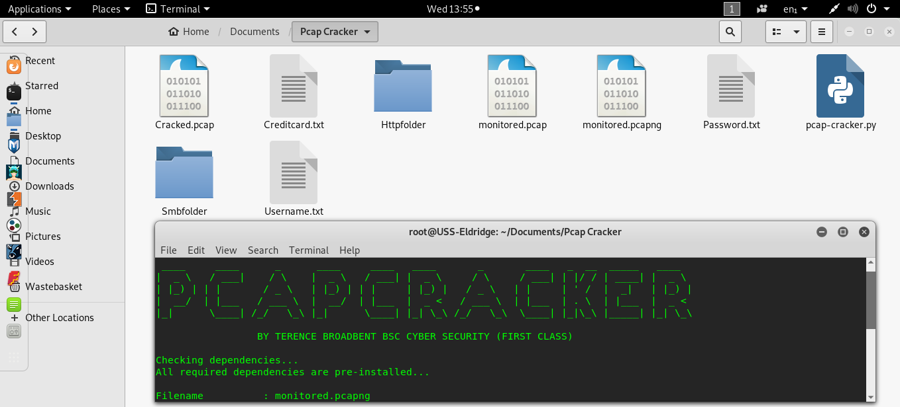

# PCAP CRACKER

*A Python-based tool for analysing IEEE 802.11 wireless network captures (.PCAP / .PCAPNG) collected using Wireshark.*

<p align="center">
  
</p>

---

## PROJECT INFORMATION

**Usage:**
```bash
python pcap-cracker.py monitored.pcapng
```

| LANGUAGE | FILENAME | MD5 HASH | CONTAINS |
|---|---|---|---|
| Python 3 | `pcap-cracker.py` | `13eb88a6e9cc879b16a87b5a934ffad3` | |
| ZIP | `Wiresharkfile.zip` | `8e2d9661621cf49a04dc2cb2064161ae` | `monitored.pcapng` |

---

## OVERVIEW

PCAP-CRACKER is a Python-based wireless network analysis project designed to examine IEEE 802.11 packet captures generated using Wireshark.

The project explores wireless network security, WEP encryption weaknesses and packet-level analysis.

The analysis workflow examines:

- Service Set Identifier (SSID) information
- Wireless security configuration
- WEP encryption weaknesses in authorised test captures
- Captured network traffic and packet information
- Export and examination of network artefacts in controlled environments

### BONUS FEATURES

Additional functionality includes automated analysis and reporting of selected network artefacts for authorised forensic investigation.

---

## CONSOLE DISPLAY



---

## LEGAL DISCLAIMER

### AUTHORISED SECURITY TESTING

This software is intended exclusively for educational purposes, authorised penetration testing and wireless network security research.

Only analyse network captures and data that you own or have explicit permission to examine.

The extraction or disclosure of credentials and other sensitive information without authorisation may constitute a criminal offence.

The developer accepts no responsibility for unauthorised use or misuse of this software.
